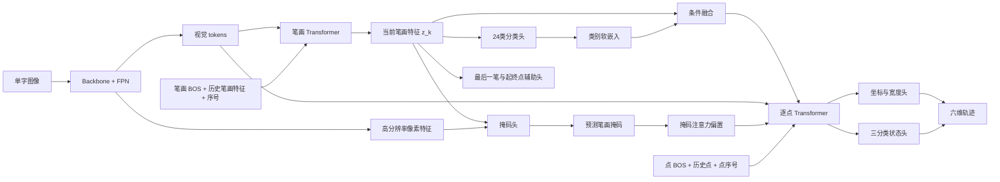
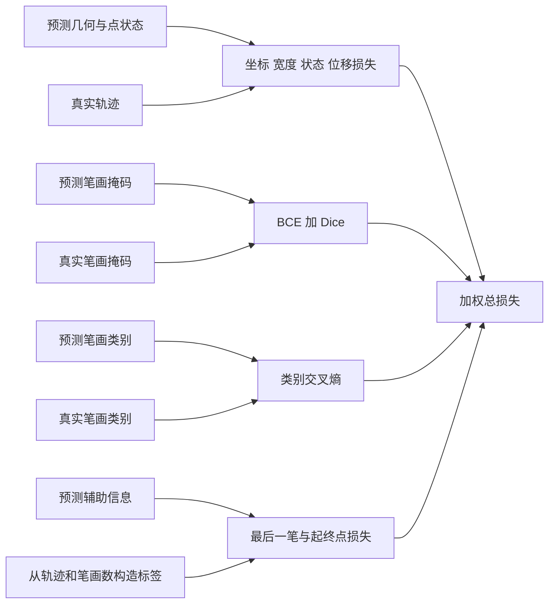

# 数据集、网络结构与损失说明

本项目输入一张书法单字图像，预测其书写轨迹：

```text
points[T,6] = [x, y, width, continue, stroke_end, drawing_end]
```

一笔对应一条连续路径。网络通过笔画掩码和类型监督学习笔画结构，并将预测结果作为轨迹生成的条件。本文以当前代码为准；已实现 teacher-forcing 训练和 image-only 自由解码，可微重绘仍待实现。运行方法见 [README.md](README.md)。

## 1. 数据集

### 1.1 文件组织

当前全量数据位于 `CHTR/data/chtr_mmah_lmdb`，采用以下统一形式：

```text
dataset/
  data.mdb                # 图像、轨迹、逐笔 PNG 及样本元数据
  lock.mdb
  summary.json            # 样本数量与打包信息
  stroke_type_map.json    # 完整 24 类编号与名称映射
```

LMDB 的 `__ids__` 保存全部样本顺序，`__ids_ready__` 列出具备合法完整轨迹的训练样本，`__meta__` 保存全局元数据。每个样本通过元数据中的 key 读取图像、原图、轨迹 NPZ 和逐笔掩码 NPZ。数据适配代码为 [lmdb_dataset.py](datasets/lmdb_dataset.py)。

### 1.2 标签及其用途

| 字段 | 内容 | 模型用途 |
| --- | --- | --- |
| `image` | 默认 256×256 灰度图 | 唯一必需的推理输入 |
| `points` | 按笔顺排列的六维点序列 | 坐标、宽度、状态及局部位移监督 |
| `stroke_offsets` | 每笔在点序列中的左闭右开边界 | 训练时拆分逐笔轨迹、关联掩码和类别 |
| `subpath_offsets` | 连续路径边界 | 本项目检查其与 `stroke_offsets` 相同 |
| `stroke_types` | 每笔的 0–23 类编号 | 笔画分类监督 |
| `stroke_index` | 样本内的笔画顺序，从 0 开始 | 按书写顺序监督笔画输出 |
| `stroke_id` | 笔画唯一标识 | 关联数据，不作为分类目标 |
| 单笔画 PNG | 白底黑笔画图像 | 转换为笔画为 1、背景为 0 的分割标签 |
| `stroke_count` | 笔画数量 | 构造最后一笔辅助标签 |
| `stroke_iou` / `quality.score` | 标签重绘质量信息 | 记录与分析；当前损失尚未质量加权 |
| `character` | 汉字名称 | 元数据与可视化；当前不做汉字分类 |
| 原始书法图像 | 未统一尺寸的原图 | 当前不参与训练，需先确认配准 |

完整映射使用 dataset 旁置的 [stroke_type_map.json](../data/chtr_mmah_lmdb/stroke_type_map.json)。其中 `id` 是 24 类标签，`name_zh` 是中文名称，`segnet_group` 是粗粒度分组；分类头使用 `id`。

数据加载时严格检查笔画数、编号、名称、轨迹范围、掩码尺寸及状态的一致性。超过网络配置的序列上限会报错，不静默截断标签。

### 1.3 六维点与边界

`x/y` 为像素坐标，`width` 为像素直径，不是压力。后三维为互斥状态，表示到达当前点之后的动作：

| 状态 | 编码 | 含义 |
| --- | --- | --- |
| 继续 | `[1,0,0]` | 当前笔画继续 |
| 笔画结束 | `[0,1,0]` | 当前笔结束，随后开始下一笔 |
| 整字结束 | `[0,0,1]` | 最后一笔与整字同时结束 |

不设置 offsets 预测头或损失。对于完整预测序列，若结束点索引为 `i_0,...,i_(K-1)`，则：

```text
stroke_offsets = [0, i_0+1, ..., i_(K-1)+1]
subpath_offsets = stroke_offsets
```

它们是便于逐笔切片的派生索引，最后一项为 T。

### 1.4 预处理与 batch

图像转换为 `[0,1]` 的 float32，默认形状为 `[1,256,256]`；轨迹归一化为 `x/255`、`y/255`、`width/256`，不同方形画布使用对应尺寸。掩码 PNG 使用 `<128` 转换为二值前景。可选增强使用同步等比例缩放和平移，同时变换图像、掩码、坐标和直径，并保留变换矩阵。

批处理将每笔独立拆出后补齐：

| 张量 | 形状 | 含义 |
| --- | --- | --- |
| `images` | `[B,1,H,W]` | 整字输入 |
| `points` | `[B,K_max,L_max,6]` | 每笔的轨迹点 |
| `masks` | `[B,K_max,H,W]` | 逐笔前景标签 |
| `types` | `[B,K_max]` | 类别标签 |
| `valid_stroke` | `[B,K_max]` | 有效笔画标记 |
| `valid_point` | `[B,K_max,L_max]` | 有效点标记 |
| `last` | `[B,K_max]` | 最后一笔为 1，其余为 0 |
| `endpoints` | `[B,K_max,4]` | 每笔起点和终点的归一化坐标 |

`B` 是 batch 大小，`K_max` 是该 batch 最大笔画数，`L_max` 是最大单笔点数。padding 不参与有效损失；逐点解码只处理有效笔画。

## 2. 网络结构

网络按三个部分理解：**提取图像特征 → 建模当前笔画 → 生成当前笔画轨迹**。所有笔画共享预测头和逐点解码器参数，网络实现见 [model.py](networks/model.py)。下列图中箭头表示数据依赖，分叉表示共享，汇合表示同时使用多个输入。



训练实现先根据 batch 的笔画数生成各笔的 `z_k`，再集中进行有效笔画的逐点预测。图中点历史在训练时来自真实上一点；自由生成的预测历史循环由 `networks/autoregressive.py` 实现。

### 信息流图中各模块的作用与引入目的

下表与图中节点逐一对应。模块的引入目的说明设计动机，不表示已经通过消融实验证明收益。

| 图中模块 | 在信息流中的作用 | 引入目的 |
| --- | --- | --- |
| **单字图像** | 提供最终墨迹形状、空间布局和粗细信息，是图像编码器的输入。 | 从静态书法图像恢复有序轨迹；推理时不要求额外标签输入。 |
| **Backbone + FPN** | Backbone 提取不同尺度的图像特征，FPN 将深层信息融合到较高分辨率特征中。 | 同时保留整字结构与局部笔画细节，为掩码和轨迹任务提供共享视觉表示。 |
| **视觉 tokens** | 将池化后的空间特征展开，并添加二维位置编码，形成两个 Transformer 的视觉 memory。 | 使笔画层和点层能通过交叉注意力读取图像；位置编码补充每个特征来自哪里的信息。它们表示整字空间，不是单笔 `z_k`。 |
| **高分辨率像素特征** | 保留二维特征图，供掩码头与当前笔画查询计算逐位置相似度。 | 为笔画覆盖区域提供较细的空间定位。默认像素特征比视觉 memory 网格更密，掩码不必仅依赖较粗的视觉 tokens。 |
| **笔画 BOS + 历史笔画特征 + 序号** | BOS 启动序列；历史 `z` 提供此前生成的笔画表示；序号嵌入标识当前生成位置。 | 给有序笔画生成提供起点、上下文及顺序信息，帮助模型区分重复类型的不同笔画。历史来自网络，不由真实掩码或类别直接构造。 |
| **笔画 Transformer** | 以因果方式处理笔画历史，并交叉读取整字视觉 tokens，输出当前笔画表示。 | 将整字视觉信息转成按标签笔顺排列的笔画序列；学习当前笔与此前笔画、整字布局的关系。 |
| **当前笔画特征 `z_k`** | 同时送入掩码、类别、辅助预测与条件融合分支，是第 k 笔的共享表示。 | 用统一笔画表示连接分割、分类和轨迹任务；各分支标签共同约束它与第 k 笔对应。不是从真实单笔 mask 提取的特征。 |
| **掩码头** | 将 `z_k` 投影为查询，与高分辨率像素特征计算相似度，得到上采样后的 mask logits。 | 将“当前笔画是哪一笔”转换成空间覆盖预测，并充分利用逐笔 PNG 标签。每笔独立预测，允许交叉处重叠。 |
| **预测笔画掩码** | logits 经 sigmoid 得到当前笔画的前景概率图，参与掩码损失并转换成注意力偏置。 | 给轨迹解码器提供“当前笔在哪里”的空间条件。掩码不包含唯一书写方向，也不直接决定起终点。 |
| **24类分类头** | 从 `z_k` 预测 24 类 logits，使用 `stroke_types` 标签监督。 | 让共享表示学习横、竖、撇、捺、折等类别信息，为轨迹提供形态先验。类别指映射文件中的类型编号，不是唯一 `stroke_id`。 |
| **类别软嵌入** | 将类别 softmax 概率与可学习的类别向量表相乘，得到 `e_k`。 | 将离散类别预测转换成可用于点解码的连续条件；保留不确定性，并允许轨迹损失经该条件回传至类别头。 |
| **条件融合** | 将 `z_k` 与 `e_k` 拼接，再线性投影成 `c_k`，加到当前笔的每个点输入上。 | 将笔画身份和类型先验同时提供给逐点预测，使同一笔的点序列具有一致的笔画条件。 |
| **最后一笔与起终点辅助头** | 从 `z_k` 预测最后一笔 logit 和四个起终点坐标，并接受独立标签监督。 | 鼓励共享表示学习整字中的位置及笔画方向。当前辅助头不直接向点层提供输入，也不控制停止或初始化；收益需通过实验验证。 |
| **掩码注意力偏置** | 按视觉网格缩放预测 mask，将其对数概率加到视觉交叉注意力分数中。 | 提高当前笔画区域的相对关注程度，减少其他笔画的干扰；使用软偏置保留读取掩码外视觉信息的能力，避免硬裁剪。 |
| **点 BOS + 历史点 + 点序号** | 点 BOS 启动每笔；历史六维点经线性嵌入；点序号表示序列位置，三者与 `c_k` 共同构成点输入。 | 提供已写路径与进度信息，支持预测下一点；因果注意力保证不读取未来标签。每笔重置点历史，但共享 BOS 参数。 |
| **逐点 Transformer** | 因果自注意力读取点历史，带 mask 偏置的交叉注意力读取视觉 tokens，前馈网络更新点特征。 | 将运动上下文、笔画条件和图像证据结合起来，学习当前笔下一点的位置、宽度与终止状态。不同笔画共享参数。 |
| **坐标与宽度头** | 将点特征线性映射为三个连续量；坐标经过 sigmoid，宽度经过 softplus 保证为正。 | 直接生成归一化绝对坐标和笔画直径，使模型能描述路径及粗细变化；其损失针对连续几何。 |
| **三分类状态头** | 将点特征映射为继续、笔画结束、整字结束三个 logits，用分类标签监督。 | 学习互斥的运动状态，并为未来变长解码提供切笔和整字终止信号，避免将三个状态作为独立连续量回归。 |
| **六维轨迹** | 将逆归一化的几何量与选定状态的 one-hot 编码组合成 `points[T,6]`。 | 提供可重绘、逐笔切片及用于后续书写执行的统一表示。训练返回几何量与状态 logits；自由解码输出轨迹及由结束状态派生的 offsets，并标记是否截断。 |

这里有两条不同的条件通路：`z_k → 类别软嵌入 → 条件融合` 为点序列提供笔画语义，`预测掩码 → 注意力偏置` 引导点层读取图像区域。点层同时直接读取视觉 tokens，因此几何预测不必完全依赖掩码或类别的正确性。

掩码、类别及辅助头各有独立损失。默认使用预测条件时，轨迹损失还会经条件融合和掩码偏置训练中间分支；最后一笔与起终点头当前通过自身损失影响共享特征，不是直接的轨迹输入。

### 2.1 第一部分：图像特征提取

这一部分为后续模块提供两类信息：

- **像素特征**保留空间细节，供掩码头定位当前笔画及其覆盖区域。
- **视觉 tokens**提供整字上下文，供两个 Transformer 通过交叉注意力读取。

当前支持自定义 CNN 和可选 ResNet-18，最小配置默认使用自定义 CNN。FPN 输出多尺度特征，隐藏维度 `D=64`。高分辨率特征在默认画布下约为 `[B,D,64,64]`；后两个尺度分别池化成 8×8 和 4×4 网格，展开并添加二维位置编码，形成 `[B,80,D]` 视觉 memory。网格大小由 `memory_size` 控制。

DINOv3 是后续可替换 backbone 候选，目前未接入；使用 ViT 时需另外设计空间特征适配。

### 2.2 第二部分：当前笔画建模

有序笔画 Transformer 按 `stroke_index` 顺序产生笔画特征 `z_k[B,D]`。第一笔使用可学习 BOS；后续读取之前生成的笔画特征，并加入笔画序号嵌入。历史特征也是网络产生的，不是真实笔画类别或 mask。当前按序展开生成所需笔画特征。

同一个 `z_k` 支持四个分支：

| 分支 | 预测内容 | 怎样帮助轨迹生成 |
| --- | --- | --- |
| 掩码头 | 当前笔画的前景概率图 | 作为软注意力引导，告诉点解码器关注哪个区域 |
| 类别头 | 24 类笔画概率 | 通过软类别嵌入提供形态先验 |
| 辅助头 | 最后一笔概率、起点与终点 | 监督共享特征；当前不直接控制停止或初始化 |
| 条件融合 | 当前笔画特征与类别嵌入的融合表示 | 为当前笔的所有点提供条件 |

掩码头将 `z_k` 投影后与像素特征计算相似度，再上采样至图像尺寸。每笔独立 sigmoid，允许笔画交叉处的掩码重叠。

类别头输出 logits，softmax 得到 `p_k[B,24]`，与可学习类别表 `E[24,D]` 相乘得到软嵌入：

```text
e_k = p_k @ E
c_k = Linear(concat(z_k, e_k))
```

类别概率保留不确定性，避免硬选某一类别成为唯一条件。掩码与类别既有独立标签监督，也直接参与轨迹生成。

### 2.3 第三部分：当前笔画的轨迹生成

逐点 Transformer 同时使用笔画条件、整字视觉特征、当前笔画掩码和历史轨迹点。第一点输入点 BOS，后续点输入上一点的六维嵌入；每笔独立处理点历史。

掩码不用于硬裁剪图像，而是在视觉交叉注意力中加入软偏置：

```text
attention_logits = QK^T / sqrt(D_head) + alpha * log(clamp(M_k, min=1e-4))
```

掩码按视觉网格缩放后与 tokens 对齐，默认 `alpha=1`。这样模型倾向于当前笔画区域，同时仍可读取其他区域。几何头用 sigmoid 预测归一化 `x/y`，用 `softplus + 1e-6` 保证宽度为正。状态头输出三类 logits，训练用交叉熵；最终轨迹状态导出为 one-hot。

**当前训练使用 teacher forcing**：输入右移一位的真实点，预测当前位置的点。因果注意力阻止读取未来点。默认 `condition_mode="predicted"` 使用预测掩码与类别；`ground_truth` 可用于真实中间条件预热。

**自由解码是后续流程**：输入自己生成的上一点；遇到 `stroke_end` 切换笔画，遇到 `drawing_end` 停止整字。当前 `forward` 根据训练 batch 的笔画数展开网络，尚不能仅凭图像自行确定生成笔画数、长度和完整终止流程。

### 2.4 当前配置与输出

| 配置 | 最小值 |
| --- | --- |
| 隐藏维度 | 64 |
| 注意力头数 | 4 |
| 笔画 / 点解码层数 | 2 / 2 |
| FFN 维度 | 256 |
| Dropout | 0.1 |
| 最大笔画数 / 最大单笔点数 | 64 / 1024 |
| 视觉网格 | 8×8 与 4×4 |

配置见 [minimal.json](configs/minimal.json) 和 [gpu.json](configs/gpu.json)。当前前向返回有效笔画的几何与状态预测，以及掩码、类别、最后一笔和起终点预测。完整图像到轨迹的推理接口、像素单位导出及派生 offsets 将在自由解码阶段实现。

AI 结构图仅作为 [视觉草稿](figures/model_architecture_draft.png)，其连线仍有遗漏，详见 [图注](figures/README.md)。以上 Mermaid 和代码定义准确的数据依赖。

## 3. 损失说明

损失实现见 [multitask.py](losses/multitask.py)。各分支都用有效标签监督，padding 不参与损失；损失计算不会把不同笔画连接起来。

### 3.1 当前已实现的损失

| 日志名称 | 预测与标签 | 计算方式 | 默认权重 |
| --- | --- | --- | ---: |
| `xy` | 预测与真实归一化坐标 | Smooth L1 | 1.0 |
| `width` | 预测与真实归一化直径 | Smooth L1 | 1.0 |
| `state` | 点状态 logits 与真实三分类 | 加权交叉熵 | 1.0 |
| `delta` | 同笔相邻点的预测与真实二维位移 | Smooth L1 | 0.5 |
| `mask_bce` | mask logits 与真实二值掩码 | BCEWithLogits | 1.0 |
| `mask_dice` | mask 概率与真实掩码 | Soft Dice loss | 1.0 |
| `type` | 24 类 logits 与真实笔画类别 | 交叉熵 | 0.5 |
| `last` | 最后一笔 logit 与二值标记 | BCEWithLogits | 0.5 |
| `endpoints` | 预测与真实起终点坐标 | Smooth L1 | 0.5 |

坐标与宽度损失约束每点几何；位移损失补充局部运动方向，只比较同笔相邻有效点。状态损失学习继续及终止，三类类别权重默认为 `[1,5,10]`，分别对应继续、笔画结束、整字结束。表中的 `state` 总权重与这组三分类权重是两层不同的加权。

掩码 BCE 监督像素前景，Dice 监督覆盖重叠；类别和辅助头使共享笔画特征同时学习类型、方向和整字中的位置。逐笔 Dice 先各自计算再平均，公式使用平滑常数 1：

```text
L_dice = mean_k(1 - (2 * sum(p_k * m_k) + 1) / (sum(p_k) + sum(m_k) + 1))
```

连续量损失对有效元素取均值，分类/辅助损失对有效笔画或点计算。当前逐点损失按有效点平均，点数多的笔画贡献更大；不是每笔先平均再等权相加。

### 3.2 总损失与监督连接

```text
L = L_xy + L_width + L_state + L_mask_bce + L_mask_dice
    + 0.5 * (L_delta + L_type + L_last + L_endpoints)
```

配置的 `loss_weights` 可覆盖各项默认系数，`state_weights` 修改点状态类别权重。当前质量分数没有参与损失加权。



默认预测条件下，轨迹损失也可以通过类别软嵌入及掩码注意力偏置，回传到分类头和掩码头。这使中间分支同时受自身标签与轨迹任务约束。

### 3.3 后续可微重绘监督

当前还未实现可微渲染或以下损失：

| 计划项 | 作用 |
| --- | --- |
| 轨迹重绘与真实逐笔掩码比较 | 约束预测坐标和宽度形成正确笔画形状 |
| 轨迹重绘与预测掩码的一致性 | 连接掩码分支与轨迹分支的几何表达 |
| 整字重绘与前景比较 | 约束整体字形覆盖 |
| 质量软加权 | 根据逐笔或整字质量调节标签监督贡献 |

可微重绘可以加入 teacher-forcing 训练，先在真实笔画分组和有效长度下渲染连续预测。OpenCV 绘图不能直接反向传播，需实现 PyTorch 软渲染。离散停止判断本身不可微，不能将自由解码终止默认视为可微操作。重绘损失衡量形状吻合，不能代替笔顺、方向和点状态监督。
