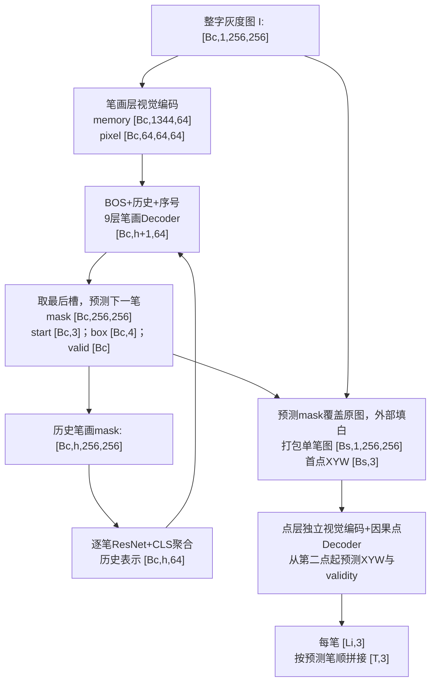
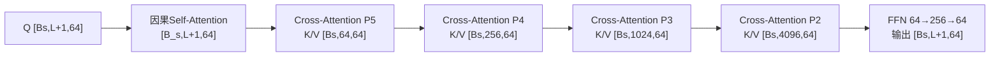

# 当前两阶段模型的信息流与张量尺寸

日期：2026-11-06。依据当前源码和CASIA正式配置静态推导；未运行模型、测试或GPU作业。
本文描述当前 `OrderedStrokeModel` + `SingleStrokeModel` 主线，不描述历史 `networks/model.py` 基线，也不把论文中未实现的组件画入模型。

## 1. 尺寸符号及配置

| 符号 | 含义 | 当前值/约束 |
| --- | --- | --- |
| H,W | 输入画布高、宽 | 256,256 |
| D | 投影后的模型特征维度 | 64 |
| A | 自定义Transformer的注意力头数 | 4；每头D/A=16 |
| F | 自定义Transformer的FFN隐藏维度 | 4D=256 |
| Bc | 笔画层batch，即整字图数量 | CASIA训练配置2、val配置1 |
| Bs | 点层batch，即单笔图数量 | 新训练配置256、独立val/test默认128 |
| Ki | 第i个字的笔画数 | CASIA上限32；当前书法配置上限64 |
| Kmax | 一个训练batch内最大笔画数 | max(Ki)，不是始终等于32 |
| S | 笔画层训练输出槽数 | Kmax+1，含最后invalid槽 |
| h | 自由推理时已经生成的笔画数 | 每轮增加1 |
| N | 打包的有效历史笔画总数 | 训练时sum(Ki)，不是Bc |
| Li | 第i笔的真实点数 | CASIA模型上限256 |
| L | 一个点层训练batch内最大真实点数 | max(Li)，动态补齐，通常小于256 |
| n | 点层自由推理时已有的点数 | 首点初始化时n=1 |
| T | 一个字的全部预测点数 | 各笔预测点数之和 |

除特别注明外，图像采用NCHW：`[batch,channel,height,width]`，token采用`[batch,sequence,feature]`。
表中的256可能表示空间尺寸、batch大小或FFN宽度，不能混同。
`D=64`只表示每个token的特征长度，不表示图像变成64×64，也不表示两阶段共享同一组特征参数。

重要区别：Swin-T内部通道和注意力头不遵循D=64/A=4；其原生四阶段通道为96/192/384/768，heads为3/6/12/24。
经过本地1×1投影后，才进入统一的64维自定义Transformer。ResNet也先保留原生通道，再投影。

## 2. 端到端信息流总图



图表示依赖关系；实际 `recover_trajectories` 先完成全部笔画实例生成，再将各字各笔打包成点层batch。
点层不是每写一个点就向笔画层反馈；两个阶段也没有直接传递64维隐藏z。

## 3. 输入与坐标：先区分图像归一化和几何归一化

1. CASIA POT原始各笔XY共享一个整字等比例变换：最长跨度映射到239px，bbox居中于127.5，边距8。
2. 同一次取样生成整字图、逐笔mask和XYW；训练W是每字每epoch采样的2～12px，val/test固定8px。
3. 灰度图像先由uint8 `[0,255]` 转成float32 `[0,1]`，形状`[1,256,256]`。
4. 几何量独立归一化：`x/255, y/255, w/256`；每个点仍是3个数，不是64维。
5. 只有进入点/笔画编码器后，数据才被投影为D=64特征。

## 4. 第一阶段A：整字视觉编码

源码：[CharacterEncoder](../networks/ordered_stroke.py:39)。

### 4.1 Swin-T主干

输入`[Bc,1,256,256]`。使用1通道4×4、stride4 patch embedding。
Swin在内部主要以NHWC工作，输出到本地FPN前转换为NCHW。

| 操作/输出 | Swin内部空间与通道 | 提交本地投影前的NCHW |
| --- | --- | --- |
| Patch embedding | [Bc,64,64,96] | — |
| Swin stage1：2个block | [Bc,64,64,96] | C2=[Bc,96,64,64] |
| Patch merging→stage2：2个block | [Bc,32,32,192] | C3=[Bc,192,32,32] |
| Patch merging→stage3：6个block | [Bc,16,16,384] | C4=[Bc,384,16,16] |
| Patch merging→stage4：2个block | [Bc,8,8,768] | C5=[Bc,768,8,8] |

原生Swin窗口/移位窗口注意力在各stage内部工作；内部窗口padding不改变这些stage输出尺寸。

### 4.2 统一通道、最粗尺度Transformer和FPN

| 步骤 | 输入 | 输出 |
| --- | --- | --- |
| C2的1×1投影：96→64 | [Bc,96,64,64] | [Bc,64,64,64] |
| C3的1×1投影：192→64 | [Bc,192,32,32] | [Bc,64,32,32] |
| C4的1×1投影：384→64 | [Bc,384,16,16] | [Bc,64,16,16] |
| C5的1×1投影：768→64 | [Bc,768,8,8] | [Bc,64,8,8] |
| 最粗尺度展平+二维位置编码 | [Bc,64,8,8] | [Bc,64,64]，即64个token，每个64维 |
| 2层Transformer Encoder | [Bc,64,64] | [Bc,64,64] |
| reshape回最粗尺度 | [Bc,64,64] | [Bc,64,8,8] |
| 自顶向下FPN融合 | 上一级2倍nearest上采样+本级64通道特征 | 8/16/32/64四个空间尺度，均64通道 |
| 每尺度3×3卷积平滑 | 各尺度[Bc,64,Hs,Ws] | 尺寸不变，得到P5/P4/P3/P2 |

自定义Encoder每层：4头自注意力→FFN（64→256→64），层归一化/残差不改变尺寸。
二维位置编码是与token逐元素相加，不是拼接，因此特征维度不会从64变128。

### 4.3 送往笔画Decoder的memory与像素特征

| 尺度 | 特征图 | 展平token | 用途 |
| --- | --- | --- | --- |
| P5 | [Bc,64,8,8] | [Bc,64,64] | 视觉memory |
| P4 | [Bc,64,16,16] | [Bc,256,64] | 视觉memory |
| P3 | [Bc,64,32,32] | [Bc,1024,64] | 视觉memory |
| P2 | [Bc,64,64,64] | 不作为该层Decoder memory | dense mask像素特征 |

前三个尺度沿token轴拼接：`64+256+1024=1344`。
最终返回：`memory=[Bc,1344,64]`，`pixel_features=[Bc,64,64,64]`。
这一步不是对1344个位置做全局平均，也没有把整个字压缩成一个64维向量。

## 5. 第一阶段B：历史笔画mask→64维历史token

源码：[HistoryEncoder](../networks/ordered_stroke.py:87)、[encode_history](../networks/ordered_stroke.py:136)。
训练输入：`history_masks=[Bc,Kmax,256,256]`，`history_active=[Bc,Kmax]`。
只取active位置，将有效mask打包为`[N,256,256]`，加单通道得到`[N,1,256,256]`。
训练中按 `history_chunk_size=16` 分块编码，每块最多16笔；这是CNN执行分块，不是整字训练batch。

| 步骤 | 输出尺寸 |
| --- | --- |
| ResNet18 conv1：7×7、stride2、1→64 | [N,64,128,128] |
| GroupNorm、ReLU、maxpool stride2 | [N,64,64,64] |
| layer1/C2 | [N,64,64,64]，这一尺度不用于历史三尺度聚合 |
| layer2/C3 | [N,128,32,32] |
| layer3/C4 | [N,256,16,16] |
| layer4/C5 | [N,512,8,8] |
| C3/C4/C5分别1×1投影到64通道 | [N,64,32,32]、[N,64,16,16]、[N,64,8,8] |
| 展平+位置编码 | [N,1024,64]、[N,256,64]、[N,64,64] |
| 每尺度可学习CLS query | [N,1,64] |
| CLS对本尺度token做4头交叉注意力+FFN | 每尺度[N,1,64] |
| 去掉CLS序列轴，每尺度一个向量 | 3个[N,64] |
| 沿特征轴拼接 | [N,192] |
| Linear(192→64)融合 | [N,64] |
| 按原active位置放回，padding位置为零 | [Bc,Kmax,64] |

这里才真正将“一整笔mask的空间特征”压成“一个64维历史笔画向量”。
历史ResNet使用GroupNorm，区别于点层ResNet的BatchNorm，避免打包处理历史时通过批统计混入未来mask信息。

## 6. 第一阶段C：历史token→下一笔实例

### 6.1 训练时一次并行计算全部槽

历史`[Bc,Kmax,64]`前拼BOS `[Bc,1,64]`，得到`[Bc,S,64]`，其中`S=Kmax+1`。
加学习的笔画序号embedding，维度保持不变；CASIA序号表为`[33,64]`。

| 组件 | 尺寸/作用 |
| --- | --- |
| Query序列 | [Bc,S,64] |
| 整字视觉memory | [Bc,1344,64] |
| 因果mask | [S,S]，禁止看未来历史 |
| key padding mask | [Bc,S]，BOS始终有效 |
| 9层Transformer Decoder | 每层输入输出均[Bc,S,64] |
| 每层FFN内部 | [Bc,S,64]→[Bc,S,256]→[Bc,S,64] |

自注意力每头Q/K/V为`[Bc,4,S,16]`；视觉交叉注意力Q为`[Bc,4,S,16]`，K/V为`[Bc,4,1344,16]`。
数学上的注意力分数形状分别为`[Bc,4,S,S]`和`[Bc,4,S,1344]`；实际算子可能融合计算，不保证显式分配完整分数张量。

输出槽对应关系（从0编号）：

```text
槽0：BOS                       → 第1笔
槽1：BOS + mask1               → 第2笔
...
槽Ki：BOS + mask1...maskKi      → invalid（整字结束）
Ki之后的槽：padding，不计损失
```

### 6.2 预测头尺寸

设Decoder最后状态为`Q=[Bc,S,64]`：

| 头 | 运算 | 输出 |
| --- | --- | --- |
| mask embedding | Linear(64→64) | [Bc,S,64] |
| dense mask | mask embedding与pixel_features沿64通道点积 | mask_logits=[Bc,S,64,64] |
| box | Linear(64→4)，sigmoid后分成center与size，再转XYXY | [Bc,S,4] |
| start XY | Linear(64→2)+sigmoid | [Bc,S,2] |
| start W | Linear(64→1)+softplus+epsilon | [Bc,S,1] |
| 拼接起点 | XY与W沿末轴拼接 | starts=[Bc,S,3] |
| validity | Linear(64→1)，去掉末轴 | valid_logits=[Bc,S] |

mask运算：`[Bc,S,64] × [Bc,64,64,64] → [Bc,S,64,64]`，实际代码为einsum。
预测mask与256×256标签比较时先双线性上采样；不是直接生成256×256个mask query。
训练时9个Decoder层共用预测头，最终层结果加8个中间层辅助结果；每个辅助结果形状与最终层相同。
当前没有终点头，也没有24类type头；validity只判断有没有下一笔。

### 6.3 自由笔画推理

已有h笔时：历史`[Bc,h,64]`，BOS后query为`[Bc,h+1,64]`。
每次只取最后槽，得到mask logits `[Bc,64,64]`、start `[Bc,3]`、box `[Bc,4]`、valid `[Bc]`。
mask logits上采样到256×256再sigmoid，得到每笔概率mask `[Bc,256,256]`。
valid<0.5则终止；否则保留该笔，并将阈值0.5的二值mask重新编码成`[Bc,1,64]`历史token，追加后预测下一笔。
整字视觉特征仅编码一次；历史笔画token按步缓存追加，Decoder仍对已有序列重新计算，当前没有KV cache。
一个字最后输出：masks `[Ki,256,256]`、starts `[Ki,3]`、boxes `[Ki,4]`、confidences `[Ki]`。
Ki不同，因此整体返回按字组织的变长列表，不直接堆为固定`[Bc,32,...]`。
多字同时推理时，已停止的字移出活跃集合，因此实际内部batch可小于最初Bc。

## 7. 两阶段接口：并不传64维隐藏特征

源码：[decode_stroke_instances](../networks/two_stage.py:20)。

对每个字的每笔，执行：

```text
原整字图 I：                [1,256,256]
预测概率mask：              [256,256]
mask>=0.5处保留I，外部填1： [1,256,256]，得到单笔灰度图
预测首点XYW：               [3]
```

不进行bbox裁剪、不重新居中、不缩放到另一个局部坐标系，单笔图保留256画布中的整字位置。
不将mask作为第二个图像通道，也不传第一阶段隐藏z、box、终点或类别。
第一阶段的64维内部表示与第二阶段的64维内部表示不是直接相接或共享权重。

全部预测笔画打包，分块送入点层：`images=[Bs,1,256,256]`，`first_points=[Bs,3]`。
串联的Bs由独立参数 `point_batch_size` 控制，当前CASIA笔画层配置为16；最后一块可以小于16。
它不同于独立点层训练256/val128，不会因为修改单笔训练配置而自动变成128。

## 8. 第二阶段A：单笔图→四尺度64维视觉token

源码：[StrokeVisualEncoder](../networks/single_stroke.py:26)。

| 步骤 | 输出尺寸 |
| --- | --- |
| 单笔灰度图 | [Bs,1,256,256] |
| ResNet18 conv1：7×7、stride2、1→64 | [Bs,64,128,128] |
| BatchNorm、ReLU、maxpool stride2 | [Bs,64,64,64] |
| layer1/C2 | [Bs,64,64,64] |
| layer2/C3 | [Bs,128,32,32] |
| layer3/C4 | [Bs,256,16,16] |
| layer4/C5 | [Bs,512,8,8] |
| 四尺度分别1×1投影到D=64 | [Bs,64,64,64]、[Bs,64,32,32]、[Bs,64,16,16]、[Bs,64,8,8] |
| 最粗C5展平+二维位置编码 | [Bs,64,64] |
| 2层Transformer Encoder | [Bs,64,64]，内部FFN为64→256→64 |
| reshape、FPN自顶向下相加、3×3平滑 | 四个空间尺度不变，每个均64通道 |

Decoder收到按P5→P4→P3→P2排序的列表：

| 列表元素 | 特征图 | 加二维位置编码后的memory |
| --- | --- | --- |
| memory[0]=P5 | [Bs,64,8,8] | [Bs,64,64] |
| memory[1]=P4 | [Bs,64,16,16] | [Bs,256,64] |
| memory[2]=P3 | [Bs,64,32,32] | [Bs,1024,64] |
| memory[3]=P2 | [Bs,64,64,64] | [Bs,4096,64] |

共5440个视觉位置，但它们没有拼成一个5440-token memory，而是保留4个独立张量，按顺序交互。
与笔画层1344-token拼接memory相比，点层显式读取高分辨率P2以定位笔内细节。

## 9. 第二阶段B：点历史→下一点XYW与有效性

### 9.1 训练输入与标签

真实每笔序列`[Li,3]`，按批内最大长度补齐后：

| 数据 | 尺寸 | 含义 |
| --- | --- | --- |
| images | [Bs,1,256,256] | GT mask覆盖原图得到的单笔图 |
| history | [Bs,L,3] | 真实点p1...pLi，剩余为padding |
| targets | [Bs,L,3] | p2...pLi；最后一个真实历史位置的几何标签不监督 |
| active | [Bs,L] bool | 位置j<Li，即包含最后invalid监督槽 |
| valid | [Bs,L] bool | 位置j<Li-1，即应预测出一个后续有效点 |
| lengths | [Bs] | 每笔原始真实长度 |

末尾invalid不需要额外追加一个历史点：使用“输入最后真实点pLi的那个输出位置”监督invalid。
第一点作为历史条件，不重新预测。单点笔画Li=1时，唯一输出位置只学习invalid，不计算几何损失。

### 9.2 点编码、BOS与序号

| 步骤 | 输入→输出 |
| --- | --- |
| 点MLP第一层 | [Bs,L,3]→[Bs,L,64] |
| GELU+第二层Linear(64→64) | [Bs,L,64]→[Bs,L,64] |
| 前拼BOS `[Bs,1,64]` | [Bs,L+1,64] |
| 加学习的点序号embedding | [Bs,L+1,64]，CASIA序号表[257,64] |
| causal mask | [L+1,L+1] |
| padding mask | [Bs,L+1]，BOS不屏蔽 |

3个几何量XYW经过MLP变成64维点表示；这里的64维是学习特征，不再逐维对应x/y/w。

### 9.3 串行解码块：下面整块重复4次

设`Q=[Bs,L+1,64]`：



每个操作都有相应pre-LayerNorm/残差，特征形状始终`[Bs,L+1,64]`。
4个串行块总计4次因果self-attention与16次视觉cross-attention；并非只有4次cross-attention。
跨注意力只改变query的内容，不将query长度变成视觉token数量。

以P2交互为例，按4头拆分：Q=`[Bs,4,L+1,16]`，K/V=`[Bs,4,4096,16]`，结果合并回`[Bs,L+1,64]`。
数学注意力分数为`[Bs,4,L+1,4096]`；这是逻辑尺寸，并非实测显存分配。

### 9.4 去BOS与输出头

4块后：LayerNorm保持`[Bs,L+1,64]`，去掉BOS位置得到`[Bs,L,64]`。

| 预测头 | 输出 |
| --- | --- |
| XY：Linear(64→2)+sigmoid | [Bs,L,2] |
| W：Linear(64→1)+softplus+epsilon | [Bs,L,1] |
| XYW拼接 | points=[Bs,L,3] |
| validity：Linear(64→1)+squeeze | valid_logits=[Bs,L] |

训练坐标/宽度损失使用valid，停止BCE使用active；padding位置不会当成真实点参与监督。

### 9.5 自由生成：只保留给定首点，之后全部反馈预测

```text
输入图像：                           [Bs,1,256,256]
给定首点：                           [Bs,3]
初始化已有点历史：                   [Bs,1,3]，n=1
点MLP+BOS+序号：                     [Bs,n+1,64]
4块解码、去BOS、预测全部历史位置：    XYW [Bs,n,3]；valid [Bs,n]
只取最后位置作为下一点候选：         [Bs,3]及[Bs]
valid>=0.5且未达cap：追加候选点        [Bs,n+1,3]
valid<0.5：结束，不保存这个无效候选的几何量
```

图像四尺度memory在一次generate中只计算一次。点Decoder每轮重算已有历史，当前没有KV cache。
已停止样本移出活跃batch；每笔结果是变长`[预测Li,3]`，并附terminated/truncated/stop_reason。
达到256点上限且未正常停止时，标记point_cap截断，不额外保存第257个点。
正常停止判定优先，因此达到上限时若同时预测invalid，记录为正常invalid停止。
首点XYW是直接保留的条件，不会被点层修正；自由生成不读取真实后续点、终点或真实点数。

## 10. 具体尺寸例子

### 10.1 两个字分别3笔和5笔

`Bc=2, Kmax=5, S=6, N=8`：

```text
images               [2,1,256,256]
history_masks        [2,5,256,256]
打包有效历史mask      [8,1,256,256] → [8,64]
还原历史表示          [2,5,64]
BOS后Decoder query   [2,6,64]
视觉memory            [2,1344,64]
mask_logits          [2,6,64,64]
starts               [2,6,3]
boxes                [2,6,4]
valid_logits         [2,6]
```

3笔字有3个valid槽+1个invalid槽+2个padding槽；5笔字有5个valid槽+1个invalid槽。
历史的padding key被屏蔽，padding query输出无需为零，但其损失被排除。

### 10.2 128笔组成评估batch，真实最长12点

Teacher forcing部分：`Bs=128, L=12`：

```text
images          [128,1,256,256]
history         [128,12,3]
嵌入并拼BOS     [128,13,64]
四尺度memory    [128,64,64] / [128,256,64] / [128,1024,64] / [128,4096,64]
4块后去BOS      [128,12,64]
predicted XYW   [128,12,3]
valid_logits    [128,12]
```

自由生成不使用这个真实L=12：只从首点开始，直到模型停止或达到256点；不同笔可以生成不同点数。
训练batch256时，把示例的batch轴128改成256，D仍然是64，不会变成256。

## 11. 输出恢复为整字

单笔归一化结果`[Li,3]`乘以`[255,255,256]`，还原像素XYW。
按第一阶段预测笔顺拼接：`points=[T,3]`，`T=sum(Li)`；同时导出`stroke_offsets=[Ki+1]`，首项0、末项T。
不存在抬笔间的插值连接点；offsets保持笔画边界，绘制时不能跨笔画连线。
同时保留mask `[Ki,256,256]`、start `[Ki,3]`、box `[Ki,4]`及两层停止原因。
源码：[infer_two_stage.py](../scripts/infer_two_stage.py)。

## 12. 参数与内存读图要点

- 256×256空间画布、训练batch256、FFN中间宽度256，数值相同但含义完全不同。
- 64维是共同的投影/解码宽度；原生Swin/ResNet各尺度通道不同，且没有跨阶段隐藏特征直连。
- 最高分辨率视觉memory含4096个token，而不是64个；低dim不等于视觉序列短。
- 训练时padding到批内最大点数L，不是固定padding到cap256；大batch更容易包含长笔画，实际代价取决于L。
- 单个float32 P2特征`[256,64,64,64]`本身就占256MiB；这只是一个张量，不是训练总显存估计，反向与其他激活还会额外占用。
- 本报告没有做显存/速度实测，不能据尺寸表保证batch256一定适配单卡。

## 13. 源码索引

- [CASIA笔画层配置](../configs/casia_ordered_stroke.json)：Swin-T、D64、9层、32笔上限。
- [CASIA点层配置](../configs/casia_single_stroke.json)：D64、4块、256点上限、训练256笔/评估128笔。
- [笔画层网络](../networks/ordered_stroke.py)：整字编码、历史编码、9层解码与预测头。
- [点层网络](../networks/single_stroke.py)：ResNet/FPN、点嵌入、串行四尺度交互和停止。
- [串联接口](../networks/two_stage.py)：预测mask覆盖原图与首点XYW传递。
- [笔画层数据及collate](../datasets/ordered_stroke.py)：动态笔数、尾invalid、history右移语义。
- [点层数据及collate](../datasets/single_stroke.py)：归一化、动态点数、next-point/invalid标签。

说明：这里列的是当前配置和静态结构；已有job1136 checkpoint仍记录原训练batch16，不因文档或新配置改动自动切换。
