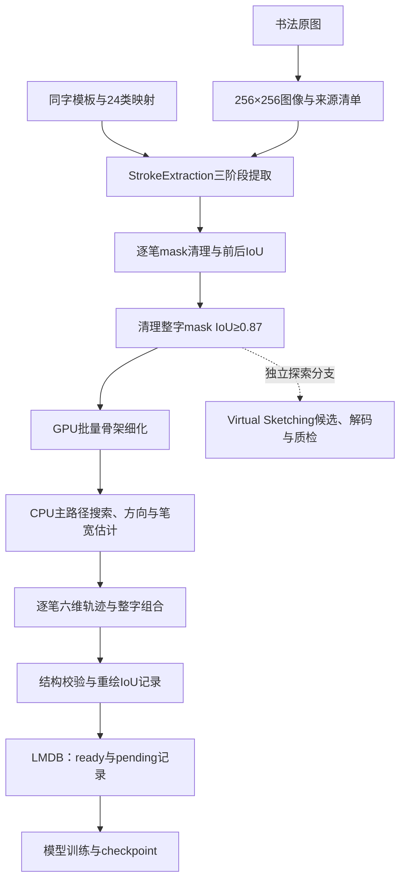

# CHTR 全量数据集构建与复现

本目录包含本地数据构建代码、统一执行入口和全量运行中间产物。
当前训练数据来自书法单字图像、修改版 StrokeExtraction 和单路径骨架轨迹路线。
这是本地复现与扩展，不代表官方 CHTR-110K 数据或人工书写轨迹真值。

## 流程与数据约定

原图来自 `chinese-calligraphy-221030`。MMAH/RHSEDB 参考资产用于同字模板、笔顺、方向和类别映射；
Make Me a Hanzi 原始图形不直接提供 StrokeExtraction 的 24 类标签。
单图作者与书体没有可靠标注，因此保持未知状态。



六维轨迹为 `[x,y,width,continue,stroke_end,drawing_end]`，坐标与宽度直径采用像素单位。
`stroke_offsets` 标识语义笔画，单路径数据要求 `subpath_offsets == stroke_offsets`。
超长笔画按弧长重采样至每笔最多 1024 点，恢复宽度并重新检查重绘质量，不直接截掉尾部。

骨架阶段的 GPU 工作是批量 Zhang-Suen 细化；图搜索、距离变换、OpenCV 重绘和文件处理仍在 CPU 上执行。
骨架标签是几何近似，不能等同于真实笔压、速度或历史书写轨迹。

## 本地实现与阶段统计

| 部分 | 实现内容 |
| --- | --- |
| 原图与参考资产 | 统一尺寸、像素极性与来源；构建同字参考库，保留笔顺、类别体系和哈希 |
| 三阶段提取 | 常驻模型批处理、同字参考缓存、并行压缩保存、错误清单及完成结果核验 |
| mask 清理 | 目标邻域约束、噪声碎块处理、短断口连接、去毛刺、平滑和填孔，记录前后 IoU |
| 单路径轨迹 | GPU 细化、CPU 主路径搜索、参考 median 定向、距离变换估计笔宽 |
| VS 独立分支 | 固定候选种子、状态解码、六维转换与重绘质检；多子路径结果需额外适配模型合同 |
| 重绘与质量 | 超采样圆笔头渲染，分别记录逐笔、整字轨迹及 mask 的指标 |
| 规模化与恢复 | 分批处理、逐笔缓存、阶段检查点、独占锁、受限预览、流式清单和磁盘索引 |
| LMDB 与模型对接 | 保存图像、原图、mask、轨迹和元数据；校验类别与 offsets，区分全部 ID 和 ready ID |
| 调度与发布 | Slurm 单卡入口、逻辑 GPU、日志、数据锁和带备份的最终库发布 |

现有全量运行记录如下；数量来自各阶段统计，质量通过数与可训练数含义不同：

| 阶段 | 数量 |
| --- | ---: |
| 规范化源图 | 138,499 |
| 有可用参考、参与提取 | 131,855 |
| 提取成功并完成清理 | 115,769 |
| 清理整字 mask IoU≥0.87，最终入库 | 73,606 |
| 对应的笔画任务 | 756,150 |
| 骨架失败笔画 | 2,238，涉及 2,149 张图 |
| 最终 ready / pending | 71,457 / 2,149 |
| 轨迹质量标记通过的样本 | 19,560 |

全量 LMDB 已完成发布。job237 使用全部 71,457 条 ready 样本完成了 100 轮训练；
其模型为本地实现，包含图像编码器、有序笔画解码器、逐点解码器和多任务损失。
训练完成不代表自由生成、泛化或机器人书写精度已经达标。

## 质量指标与训练筛选

- `stage_iou.mask_extraction_whole`：清理前，各笔画 mask 并集与目标图的整字 IoU。
- `stage_iou.mask_cleanup_whole`：清理后，同一并集与目标图的整字 IoU。
- `stage_iou.trajectory_whole`：整字六维轨迹重绘与同一目标图的 IoU。

当前库的准入条件为清理整字 mask IoU≥0.87；轨迹 IoU 作为元数据，低分不会直接排除入库。
训练加载器跳过 pending，默认不额外按 IoU 筛选。`--min-trajectory-iou` 与 `--min-mask-iou`
可分别限制轨迹及 mask 质量，两者按 AND 组合；mask 默认使用清理后指标，可切换到清理前。
筛选不删除 LMDB 记录，降低阈值也无法找回原本没有入库的其他图像。
整字 IoU 不能单独证明笔画归属、顺序、方向或逐笔连通性正确。

## 统一命令文件

入口：[build_full_dataset.slurm](build_full_dataset.slurm)。一个文件串联三步：

1. 选择全部有参考模板的图像，运行 SDNet / SegNet / ExtractNet，清理笔画 mask。
2. 每批 100 张图，GPU 分批细化、CPU 图追踪、宽度恢复、重绘和模型数据合同检查。
3. 重用全部骨架批次，保留清理合格的所有样本，重封装并发布最终 LMDB。

第三步保留低轨迹 IoU 样本，IoU 作为真实元数据；缺少合法完整轨迹的样本标为 pending。
第二步的严格筛选结果只是中间产物，不会先将 1915 张严格集发布为最终训练库。
当前全量库为 **73,606 条记录：71,457 条 ready、2,149 条 pending**。

## 查看计划

在工作区根目录运行；只打印命令，不写入文件、不执行 GPU 计算：

```bash
cd /home/lkh/workspace
CHTR_PYTHON=python3 bash CHTR/reproduction/build_full_dataset.slurm --dry-run
```

默认指向已有全量运行。已完成的提取/清理和完整骨架批次会被复用，不重写历史配置及内容指纹。
未完成的骨架阶段仍由原有脚本检查输入、代码和配置一致性。
存在不完整的全局 mask 清理目录时，入口会停止，要求检查或另用新目录，不自动删除中间文件。

## 从头构建全量数据集

使用新的 `--run` 和 `--dataset`，在工作区根目录提交单卡作业：

```bash
cd /home/lkh/workspace
mkdir -p logs
gpu-sbatch --user_name lkh CHTR/reproduction/build_full_dataset.slurm \
  --run /home/lkh/workspace/CHTR/reproduction/pipeline_runs/calligraphy_full_rebuild \
  --dataset /home/lkh/workspace/CHTR/data/chtr_mmah_lmdb_rebuild
```

默认申请 1 张 GPU、4 CPU、32G 内存，沿用现有 Python 环境，不自动启动训练。
其他账户提交时替换 `--user_name`。Slurm 默认时限仍有效，未设置自动续交。

## 复用已有中间产物

默认运行目录：`pipeline_runs/calligraphy_full_gpu0_20261013_134511_2134141/`。

从已完成清理之后继续骨架与重封装：

```bash
gpu-sbatch --user_name lkh CHTR/reproduction/build_full_dataset.slurm --from-stage skeleton
```

仅重封装已完整生成的骨架批次：

```bash
gpu-sbatch --user_name lkh CHTR/reproduction/build_full_dataset.slurm --from-stage pack
```

发布沿用原 `repack_all_clean.py` 的校验和数据锁，目标库已存在时保留时间戳备份。
目标库已经对应相同 manifest 时，重封装器会识别已发布状态。
不要同时提交多个入口处理同一运行目录。

## 主要参数与依赖

| 参数 / 环境变量 | 用途 |
| --- | --- |
| `--run` | 全量中间产物目录 |
| `--dataset` | 最终 LMDB 目录 |
| `--pack-output` | 代码迁移后重建重封装缓存时，指定新的缓存目录 |
| `--source-manifest` | 新运行的原始书法数据清单 |
| `--mmah-bank` | 新运行的同字参考模板库清单 |
| `--stroke-type-map` | 24 类笔画映射 |
| `--from-stage prepare/skeleton/pack` | 指定起始阶段 |
| `--batch-size` / `--gpu-batch-size` / `--workers` | 默认 100 / 64 / 3 |
| `--quality-threshold` | mask 清理 IoU 阈值，默认 0.87 |
| `CHTR_PYTHON` | 指定现有 PyTorch/LMDB 环境 Python |
| `CHTR_WORKSPACE` | 显式指定工作区根目录；通常由 Slurm 提交目录确定 |

该入口固定每笔最多 1024 点，与现有全量重封装器合同一致。
已有运行以其 `run_config.json` 的源数据、参考库和权重配置为准。
更改配置、输入或代码后，不应篡改完成标记来继续，应使用新运行目录。
已发布且 manifest 匹配的最终库可直接复用；如果需要按新代码重新封装旧骨架，使用
`--from-stage pack --pack-output /absolute/path/to/new-pack-cache` 创建新的重封装缓存。

三阶段权重位于 `CHTR/third_party/StrokeExtraction/out/*_MMAH_CCSEDB_v4/model/`；默认解释器为
`CHTR/third_party/StrokeExtraction/.venv/bin/python`。两个修改版依赖均已移入 `CHTR/third_party/`，
原工作区位置保留兼容软链接以读取历史路径；详见 [第三方目录说明](../third_party/README.md)。
统一入口采用骨架路线，不运行 Virtual Sketching；VS 原方法代码仍在 `pipeline/` 中。
原始图像、处理后的 Make Me a Hanzi 资源和提取权重在 `pipeline_runs` 外，仍需单独准备。

## 保留的全量产物

清理后 `pipeline_runs/` 保留：

```text
calligraphy_full_gpu0_20261013_134511_2134141/
  selected/                       全量输入及参考清单
  extracted/                      三阶段笔画提取产物
  mask_cleanup/                   清理后的 mask、报告与清单
  skeleton_continuation_v1/        分批骨架、逐笔缓存和严格集
  skeleton_all_clean_v1/           全部清理合格样本及重封装中间产物
mmah_reference_bank_20260918/      全量提取实际使用的同字参考库
mmah_single_path_gpu2_20261005_five/
  dataset_simplified_dataloader_v2/stroke_type_map.json
```

最后一项仅保留历史类别表，原数据脚本默认值和内容签名仍引用该位置；其他试验产物删除。
清理记录见 [pipeline_runs_cleanup.json](pipeline_runs_cleanup.json)。最终 LMDB 在
`../data/chtr_mmah_lmdb/`，训练结果在 `../models/runs/`，均不属于本次清理范围。

实现细节见 [pipeline/README_zh.md](pipeline/README_zh.md) 和
[../data/README.md](../data/README.md)。旧试验输出链接可能已被清理，
具体算法与脚本仍保留。旧三个 Slurm 文件在工作区 `archive/training_cleanup_20261016/slurm/`，
当前统一使用本目录的新入口。

## 迁移到个人电脑

[package_assets.py](package_assets.py) 可将完整 CHTR 源码与明确选择的权重、数据集打成一个包，
保留 `CHTR/` 原目录结构。默认携带全量和 1915 两套 LMDB、job237 的 epoch 100 权重、
MMAH_CCSEDB_v4 三阶段提取权重和 VS 推理 checkpoint，不携带环境和第三方训练数据。
CPU 打包作业入口为 [package_assets.slurm](package_assets.slurm)；解压和本地评估方法见
[LOCAL_EPOCH100.md](LOCAL_EPOCH100.md)。

## 本次验证范围

统一入口的 Shell/内嵌 Python 语法和只读 `--dry-run` 已检查；本次没有启动全量重建作业。
运行中的 GPU 和数据环境仍需由 Slurm 分配并按实际任务验证。
